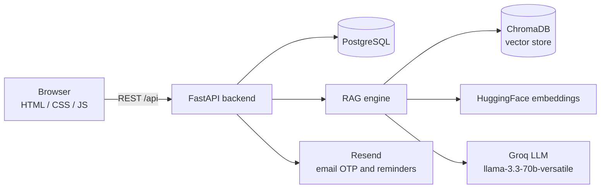

# lmtiCore - AI-Powered Cybersecurity Compliance Platform


lmtiCore (formerly CyberGuard GRC) is a Governance, Risk, and Compliance (GRC) web platform that helps organizations assess themselves against the Saudi **National Cybersecurity Authority (NCA) Essential Cybersecurity Controls (ECC)**. It replaces manual spreadsheet audits with AI-generated audit questions, automatic compliance scoring, gap analysis, an evidence repository, and scheduled re-assessments.

> Graduation project, Umm Al-Qura University, Cybersecurity (2025-2026).

## The problem

Compliance with the ECC is hard to sustain because:

- Assessments are done manually, control by control.
- Evidence is scattered across files, emails, and folders.
- It is difficult to see where the gaps are, or how compliance changes over time.

## Features

| Area | What it does |
|---|---|
| **AI audit guidance** | Generates 10 control-specific audit questions per control (Yes / Partial / No) using retrieval-augmented generation over the ECC text. |
| **Compliance scoring** | Scores each control from the answers (Yes = 100, Partial = 50, No = 0) and rolls scores up by domain and category. |
| **Gap analysis and recommendations** | Flags weak controls and stores prioritized gaps with AI-generated remediation recommendations. |
| **Dashboard** | Overall score, audit progress, per-domain scores, critical gaps, and alerts. A control counts as compliant at 80% or above, partial between 40% and 79%, and non-compliant below 40%. |
| **Evidence management** | Upload evidence files per control and keep a permanent, append-only record of every completed audit session. |
| **Audit scheduler** | Schedule one-off or recurring (weekly, monthly, quarterly) audits, with automatic email reminders at 7, 3, and 1 days before. |
| **Chatbot** | Ask implementation questions about a specific control and get answers grounded in the ECC text. |
| **Accounts and roles** | Registration with email OTP verification, password reset, profile management, and an admin panel (Admin / Auditor / User roles). |

## Architecture



**How the AI part works:** the ECC controls (`data/ecc_controls.json`) are split into chunks, embedded with a multilingual sentence-transformer model, and stored in ChromaDB. When a user opens a control, the engine retrieves that control's text and passes it to the LLM with a task-specific prompt (audit questions, recommendations, gap analysis, or guidance), so answers stay tied to the source text instead of the model's general knowledge.

## Tech stack

- **Backend:** Python 3.11, FastAPI, Uvicorn, psycopg2, SQLAlchemy, bcrypt
- **AI / RAG:** LangChain, ChromaDB, sentence-transformers (`paraphrase-multilingual-mpnet-base-v2`), Groq (`llama-3.3-70b-versatile`)
- **Database:** PostgreSQL
- **Frontend:** HTML, CSS, vanilla JavaScript
- **Email:** Resend API
- **Infrastructure:** Docker, Railway

## Repository structure

```
.
├── backend/
│   ├── app/
│   │   ├── main.py            # FastAPI app and API routes
│   │   ├── config.py          # Settings (environment-driven)
│   │   ├── ai/                # RAG engine and prompts
│   │   ├── services/          # Scoring and RAG services
│   │   ├── models/            # SQLAlchemy models
│   │   └── utils/             # ECC parsing and helpers
│   ├── data/                  # ECC controls (JSON + source PDF)
│   ├── ingest.py              # Builds the ChromaDB vector store
│   ├── requirements.txt
│   └── Dockerfile
├── frontend/                  # Static pages and JS
│   ├── landing.html, index.html, login.html, register.html
│   ├── dashboard.html, audit.html, evidence.html
│   ├── scheduler.html, chatbot.html, profile.html
│   └── js/, css/
├── data/                      # ECC controls (JSON + source PDF)
└── docker-compose.yml
```

## Getting started

### Prerequisites

- Python 3.11
- PostgreSQL 15 or newer
- A [Groq API key](https://console.groq.com/) (for the AI features)
- Optional: a [Resend](https://resend.com/) API key (for OTP and reminder emails)

### 1. Clone and install

```bash
git clone https://github.com/abdullah-alk/gradproject2026.git
cd gradproject2026/backend
python -m venv .venv
source .venv/bin/activate        # Windows: .venv\Scripts\activate
pip install -r requirements.txt
```

The first AI request downloads the embedding model, so expect a one-time delay.

### 2. Configure environment variables

Create `backend/.env` (it is git-ignored):

```env
DATABASE_URL=postgresql://<user>:<password>@localhost:5432/<database>
SECRET_KEY=<long-random-string>
GROQ_API_KEY=<your-groq-key>
RESEND_API_KEY=<your-resend-key>
```

| Variable | Required | Purpose |
|---|---|---|
| `DATABASE_URL` | Yes | PostgreSQL connection string |
| `GROQ_API_KEY` | For AI features | LLM access (Groq) |
| `SECRET_KEY` | Yes | Application secret |
| `RESEND_API_KEY` | For email | OTP verification and audit reminders |
| `CHROMA_PERSIST_DIRECTORY` | No | Vector store location (default `./data/vector_store`) |
| `EMBEDDING_MODEL` | No | Embedding model (default `sentence-transformers/paraphrase-multilingual-mpnet-base-v2`) |

Generate a secret with `python -c "import secrets; print(secrets.token_hex(32))"`. Never commit real keys or passwords.

### 3. Prepare the database

Create an empty PostgreSQL database and the tables the app uses: `users`, `ecc_controls`, `audit_sessions`, `audit_qa`, `compliance_scores`, `gaps_recommendations`, and `evidence`. Then load the controls from `backend/data/ecc_controls.json` into `ecc_controls`.

### 4. Build the vector store (optional)

The vector store is built automatically on the first AI request. To build it ahead of time:

```bash
python ingest.py
```

### 5. Run the backend

```bash
uvicorn app.main:app --reload
```

The API runs at `http://localhost:8000`, with interactive docs at `http://localhost:8000/docs`.

### 6. Run the frontend

In `frontend/js/api.js`, set `API_BASE_URL` to `http://localhost:8000/api`, then serve the folder:

```bash
cd ../frontend
python -m http.server 5500
```

Open `http://localhost:5500/landing.html`.

## API overview

| Group | Endpoints |
|---|---|
| **Auth** | `POST /api/register`, `POST /api/auth/login`, `POST /api/auth/send-otp`, `POST /api/auth/verify-otp`, `POST /api/auth/reset-password` |
| **Controls** | `GET /api/controls/`, `GET /api/controls/hierarchy`, `GET /api/controls/{control_id}`, `POST /api/controls/{control_id}/status` |
| **AI** | `POST /api/ai/generate-questions`, `POST /api/ai/recommendations`, `POST /api/ai/process` |
| **Audits** | `POST /api/audit/session/start`, `POST /api/audit/session/answer`, `POST /api/audit/session/complete`, `POST /api/audit/compliance-score`, `GET /api/audit/sessions` |
| **Dashboard** | `GET /api/dashboard/stats`, `GET /api/dashboard/domain-scores`, `GET /api/dashboard/category-scores`, `GET /api/dashboard/gaps`, `GET /api/alerts` |
| **Evidence** | `POST /api/evidence/upload`, `POST /api/evidence/save`, `GET /api/evidence/` |
| **Gaps** | `POST /api/gaps/save`, `GET /api/gaps/` |
| **Scheduler** | `GET /api/scheduler/recommendations`, `POST /api/scheduler/schedule`, `DELETE /api/scheduler/schedule/{id}`, `POST /api/scheduler/auto`, `POST /api/scheduler/send-reminders` |
| **Profile and admin** | `GET /api/profile`, `POST /api/profile/update`, `POST /api/profile/change-email`, `GET /api/admin/users`, `GET /api/admin/stats` |

## Deployment

The backend and frontend are deployed on [Railway](https://railway.app/). The backend reads its port from the `PORT` environment variable, and all secrets are supplied through Railway environment variables rather than the codebase. The AI engine is loaded lazily on the first AI request to keep startup memory low on small instances.

## Scope

The platform currently covers the first ten ECC governance controls (1-1 to 1-10) and their sub-controls, 68 entries in total: strategy, management, policies and procedures, roles and responsibilities, risk management, IT project management, compliance, review and audit, human resources, and awareness and training.

## Roadmap

- Extend coverage to the remaining ECC domains and subdomains
- Signed JWT sessions with token expiry and refresh
- Restrict CORS to known origins and add rate limiting
- Database migrations (Alembic) and a reproducible schema script
- Automated tests and a CI pipeline
- Exportable audit reports (PDF)

## Team

Built by a team of four:

- Abdullah Alkhozaai ([@abdullah-alk](https://github.com/abdullah-alk))
- Fahad Alotaibi
- Omar Al-Waqdani
- [@0xAzzam](https://github.com/0xAzzam)

## Acknowledgements

Control content is based on the NCA Essential Cybersecurity Controls (ECC) published by the Saudi National Cybersecurity Authority.
